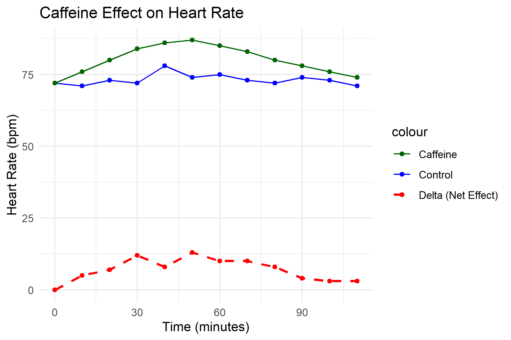
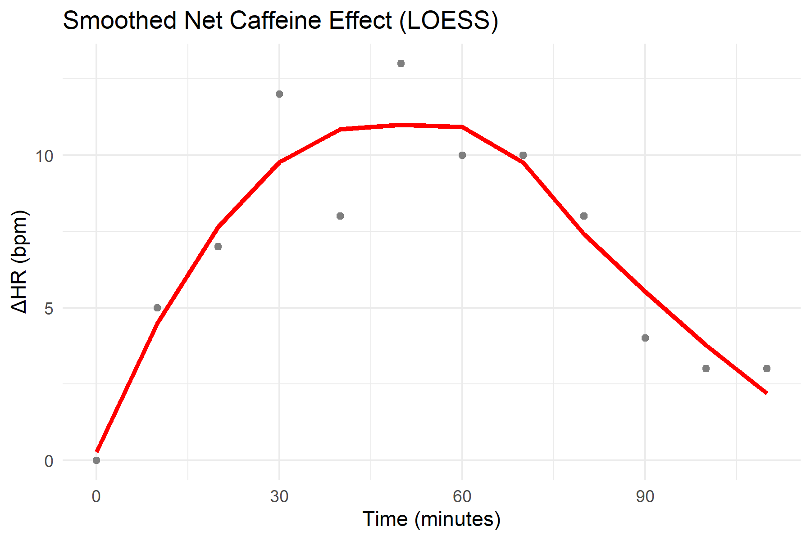

<div align="center">

# Caffeine Effect on Heart Rate — Interactive PD Analysis


</div>

An interactive R script that quantifies the pharmacodynamic (PD) effect of caffeine on resting
heart rate using a **self-controlled crossover design**. It turns a small time–effect dataset into
the core PD metrics — **Tmax**, **Emax**, and **AUC** — and renders publication-ready figures.

## Overview

The script compares heart rate on a **control day** and a **caffeine day** measured in the same
person, so each subject acts as their own control. The net effect (ΔHR) is the difference between
the two curves, and the PD metrics describe its magnitude and time course — the same
"dose → effect → quantification" logic used in clinical PD analysis.

## Study design

| Item | Value |
| --- | --- |
| Design | Self-controlled crossover (control vs. caffeine) |
| Sampling | 12 time points, every 10 min from 0 to 110 min |
| Signal | Resting heart rate (bpm) |
| Net effect | ΔHR = HR<sub>caffeine</sub> − HR<sub>control</sub> |

## Methods

1. **Net effect** — compute ΔHR at each time point as the paired difference between the caffeine
   and control series, removing any subject-specific baseline offset.
2. **Metrics** — Tmax (time of peak effect), Emax (maximum net HR increase), and AUC over
   0–110 min by the trapezoidal rule.
3. **Trend** — a LOESS smoother describes the temporal shape of the net effect without imposing a
   fixed parametric form.

## Built-in demo data

Choosing option `1` runs the analysis on a demo dataset:

| Time (min) | 0 | 10 | 20 | 30 | 40 | 50 | 60 | 70 | 80 | 90 | 100 | 110 |
| --- | ---: | ---: | ---: | ---: | ---: | ---: | ---: | ---: | ---: | ---: | ---: | ---: |
| Control (bpm) | 72 | 71 | 73 | 72 | 78 | 74 | 75 | 73 | 72 | 74 | 73 | 71 |
| Caffeine (bpm) | 72 | 76 | 80 | 84 | 86 | 87 | 85 | 83 | 80 | 78 | 76 | 74 |
| ΔHR (bpm) | 0 | 5 | 7 | 12 | 8 | 13 | 10 | 10 | 8 | 4 | 3 | 3 |

**Demo result:** Tmax = 50 min · Emax = 13 bpm · AUC = 815 bpm·min.

## Results

### Raw heart-rate profiles



Control and caffeine heart-rate profiles (solid lines) together with the net effect ΔHR (dashed
line). The caffeine curve rises above control within the first 10 minutes and stays elevated
through the session.

### Smoothed net effect



LOESS smoother over the ΔHR points: a clear rise to a plateau around 40–60 min and a gradual decay
afterwards, with no fixed parametric shape assumed.

## Output

Running the script prints the PD metrics to the console and saves both figures to the working
directory at 300 dpi:

| Metric | Meaning | Demo value |
| --- | --- | ---: |
| Tmax | time to peak net effect | 50 min |
| Emax | maximum net HR increase | 13 bpm |
| AUC | net effect over 0–110 min (trapezoidal) | 815 bpm·min |

- `caffeine_curves_raw.png` — raw control / caffeine / net-effect curves
- `caffeine_curves_smoothed.png` — smoothed net-effect curve

## How to run

1. Install R (>= 4.0) and, optionally, RStudio.
2. Install the required package:

   ```R
   install.packages("ggplot2")
   ```

3. Open `Caffeine-HeartRate-PD-Model.R` in RStudio and click **Source** (or press
   `Ctrl + Shift + Enter`).
4. In the console, choose how to provide data:
   - `1` — use the built-in demo data (no file needed)
   - `2` — read from a CSV file (recommended)
   - `3` — type 12 numbers by hand
5. The script prints the metrics and saves the figures.

## CSV input format (option 2)

A plain text file with **no header** and **two columns** (comma- or space-separated):

```csv
72, 72
71, 76
73, 80
72, 84
78, 86
74, 87
75, 85
73, 83
72, 80
74, 78
73, 76
71, 74
```

- Column 1: heart rate on the **control day** (no caffeine)
- Column 2: heart rate on the **caffeine day**
- Exactly 12 rows (one every 10 minutes, from 0 to 110 min)

## Repository structure

| File | Description |
| --- | --- |
| `Caffeine-HeartRate-PD-Model.R` | Interactive analysis script (data input, PD metrics, figures). |
| `caffeine_curves_raw.png` | Raw control / caffeine / net-effect curves. |
| `caffeine_curves_smoothed.png` | LOESS-smoothed net-effect curve. |

## Requirements

- R (>= 4.0)
- `ggplot2`

## Notes

- This is a personal exploratory tool, not a clinical diagnostic; all results are based on the
  user's own input data.
- The interactive console prompts are currently written in Chinese.
- With only 12 observations per condition, the metrics (especially AUC and Tmax) are sensitive to
  measurement noise; the LOESS curve is a descriptive summary, not an inferential model.
